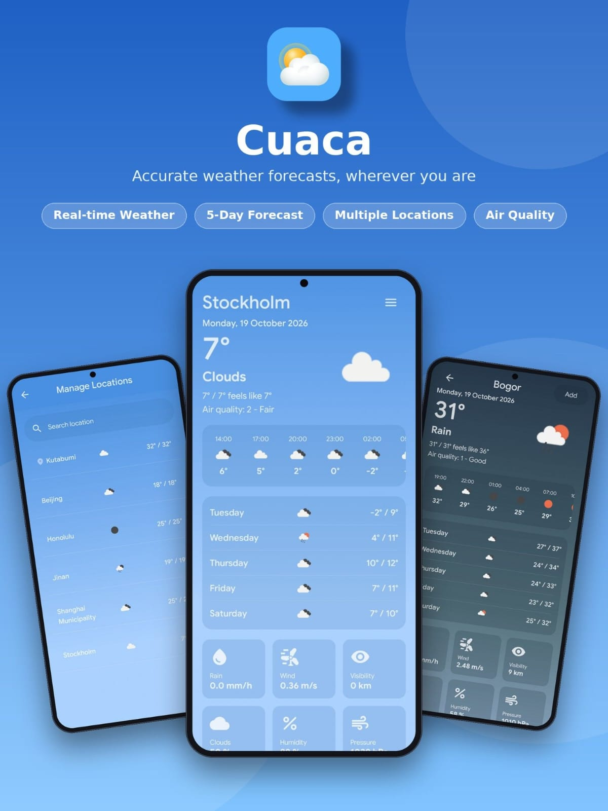

# 🌤️ TheWeather



Cuaca is an Android application built using Modern Android Development (MAD) practices, Clean Architecture, and Jetpack Compose. The application provides real-time weather forecasts, air quality metrics, and location search capabilities. It uses an offline-first data synchronization strategy with local caching and background worker updates.

📥 **[Download the Latest APK](app-release.apk)** to install and try the application on your Android device.

---

## 📖 Project Description

The application follows Clean Architecture principles, splitting responsibilities across `domain`, `data`, and `presentation` layers. 

- 💾 **Offline-First Architecture**: Serves cached data instantly from local Room persistence before making network requests.
- 🌐 **RESTful API Integration**: Fetches live weather conditions, daily forecasts, air pollution indices, and location queries from the [OpenWeather API](https://openweathermap.org/api).
- 🔄 **Background Synchronization**: Keeps cached location and weather metrics up-to-date using periodic WorkManager tasks.
- 🎨 **Reactive UI**: Utilizes declarative Jetpack Compose interfaces powered by Kotlin Flows and state management abstractions.

---

## 🛠️ Architecture and Key Techniques

The codebase uses several key architectural techniques:

- 🎭 **Demonstration of MVVM & MVI Patterns (UDF)**: Demonstrates both MVVM and MVI architectural patterns under Unidirectional Data Flow (UDF) backed by Jetpack Compose `StateFlow` to showcase flexible UI state management:
  - **MVVM in [`DetailViewModel.kt`](app/src/main/java/com/lattae/cuaca/presentation/ui/detail/viewmodel/DetailViewModel.kt)**: Uses direct ViewModel method calls (`loadDetailWeather()`, `saveLocation()`) tailored for straightforward, lifecycle-driven state loading.
  - **MVI in [`SearchViewModel.kt`](app/src/main/java/com/lattae/cuaca/presentation/ui/search/viewmodel/SearchViewModel.kt)**: Processes explicit user intents through a sealed `SearchEvent` hierarchy (`onEvent(SearchEvent)`), managing interactive search streams (query debounce, clearing input, location deletion) in a single event pipeline.
- 🌐 **Type-Safe Networking with Retrofit Interceptors**: Implements [Retrofit](https://square.github.io/retrofit/) service definitions in [`app/src/main/java/com/lattae/cuaca/data/remote/api/WeatherApiService.kt`](app/src/main/java/com/lattae/cuaca/data/remote/api/WeatherApiService.kt). Configures an `OkHttpClient` interceptor in [`app/src/main/java/com/lattae/cuaca/di/AppModule.kt`](app/src/main/java/com/lattae/cuaca/di/AppModule.kt) to append API credentials (`appid`), measurement units (`units=metric`), and localization (`lang=en`) to all outgoing HTTP calls.
- 🔄 **Offline-First Cache and Refresh Pattern**: Implemented in [`app/src/main/java/com/lattae/cuaca/domain/usecase/WeatherUseCases.kt`](app/src/main/java/com/lattae/cuaca/domain/usecase/WeatherUseCases.kt). The `GetWeatherDetailUseCase` emits local database state before initiating a network call, following the [Android Offline-First Architecture Guidelines](https://developer.android.com/topic/architecture/data-layer/offline-first) and caching concepts.
- ⚡ **Concurrent Async Operations**: Uses Kotlin Coroutines [`coroutineScope`](https://kotlinlang.org/api/kotlinx.coroutines/kotlinx-coroutines-core/kotlinx.coroutines/coroutine-scope.html), [`async`](https://kotlinlang.org/api/kotlinx.coroutines/kotlinx-coroutines-core/kotlinx.coroutines/async.html), and [`awaitAll`](https://kotlinlang.org/api/kotlinx.coroutines/kotlinx-coroutines-core/kotlinx.coroutines/await-all.html) in [`app/src/main/java/com/lattae/cuaca/domain/usecase/WeatherUseCases.kt`](app/src/main/java/com/lattae/cuaca/domain/usecase/WeatherUseCases.kt) to execute parallel network fetches across multiple saved locations.
- 💉 **Assisted Injection in Background Workers**: Implements `@HiltWorker` and `@AssistedInject` in [`app/src/main/java/com/lattae/cuaca/workers/CacheWorker.kt`](app/src/main/java/com/lattae/cuaca/workers/CacheWorker.kt) to inject domain use cases directly into background workers managed by Android WorkManager.
- ⏱️ **Periodic Background Syncing with Constraints**: Configures background syncs with a 15-minute interval and network connectivity constraints in [`app/src/main/java/com/lattae/cuaca/workers/CacheRepository.kt`](app/src/main/java/com/lattae/cuaca/workers/CacheRepository.kt) using [`PeriodicWorkRequestBuilder`](https://developer.android.com/reference/androidx/work/PeriodicWorkRequest).

---

## 🧰 Technologies and Libraries

- 🌤️ **[OpenWeather API](https://openweathermap.org/api)**: Provides underlying RESTful endpoints for real-time weather metrics (`/data/2.5/weather`), 5-day daily forecasts (`/data/2.5/forecast`), air pollution indices (`/data/2.5/air_pollution`), and geocoding (`/geo/1.0/direct`).
- 🔌 **[Retrofit & Gson Converter (`com.squareup.retrofit2:retrofit`)](https://square.github.io/retrofit/)**: Type-safe HTTP client used with OkHttp logging interceptors to handle async RESTful requests and deserialize JSON payloads into Kotlin DTOs in [`app/src/main/java/com/lattae/cuaca/data/remote/dto/`](app/src/main/java/com/lattae/cuaca/data/remote/dto/).
- ⚡ **[Hilt WorkManager Integration (`androidx.hilt:hilt-work`)](https://developer.android.com/training/dependency-injection/hilt-jetpack#workmanager)**: Facilitates Dagger Hilt dependency injection into WorkManager workers using annotation processing.
- 🖼️ **[Coil Compose (`io.coil-kt:coil-compose`)](https://coil-kt.github.io/coil/compose/)**: Coroutine-backed image loading library for rendering remote icons in Jetpack Compose UI.

---

## 📂 Project Structure

```
TheWeather/
├── build.gradle.kts
├── gradle.properties
├── gradle/
│   └── libs.versions.toml
└── app/
    ├── build.gradle.kts
    ├── sampledata/
    └── src/
        ├── androidTest/
        ├── test/
        └── main/
            ├── res/
            │   ├── drawable/
            │   ├── font/
            │   ├── mipmap-*/
            │   ├── values/
            │   └── xml/
            └── java/com/lattae/cuaca/
                ├── common/
                ├── data/
                │   ├── local/
                │   ├── location/
                │   ├── mapper/
                │   ├── remote/
                │   │   ├── api/
                │   │   └── dto/
                │   └── repository/
                ├── di/
                ├── domain/
                │   ├── location/
                │   ├── model/
                │   ├── repository/
                │   └── usecase/
                ├── presentation/
                │   ├── components/
                │   ├── theme/
                │   └── ui/
                │       ├── detail/
                │       │   └── contents/
                │       ├── navigation/
                │       └── search/
                ├── util/
                └── workers/
```

### 🧭 Directory Descriptions

- [`app/src/main/java/com/lattae/cuaca/domain/`](app/src/main/java/com/lattae/cuaca/domain/): Contains domain models, repository interfaces such as [`IWeatherRepository.kt`](app/src/main/java/com/lattae/cuaca/domain/repository/IWeatherRepository.kt), and business logic use cases isolated from framework dependencies.
- [`app/src/main/java/com/lattae/cuaca/data/`](app/src/main/java/com/lattae/cuaca/data/): Manages data sources including Room database persistence in [`LocationDao.kt`](app/src/main/java/com/lattae/cuaca/data/local/LocationDao.kt), Retrofit network DTOs like [`AirConditionDto.kt`](app/src/main/java/com/lattae/cuaca/data/remote/dto/AirConditionDto.kt), and location providers.
- [`app/src/main/java/com/lattae/cuaca/workers/`](app/src/main/java/com/lattae/cuaca/workers/): Houses WorkManager tasks like [`CacheWorker.kt`](app/src/main/java/com/lattae/cuaca/workers/CacheWorker.kt) and repositories for background caching.
- [`app/src/main/java/com/lattae/cuaca/presentation/`](app/src/main/java/com/lattae/cuaca/presentation/): Contains Jetpack Compose UI components, Material Design 3 screens, theme definitions, and navigation graphs.
- [`app/src/main/java/com/lattae/cuaca/di/`](app/src/main/java/com/lattae/cuaca/di/): Configures Dagger Hilt dependency injection modules for database, network, repository, and worker instances.
- [`app/src/main/res/font/`](app/src/main/res/font/): Contains custom bundled font assets, including [Google Sans](https://fonts.google.com/).
